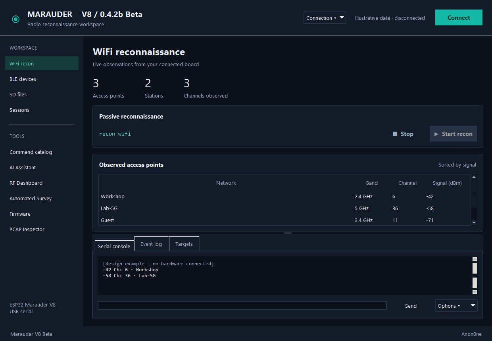

# Marauder V8 Control — 0.4.2b Beta

0.4.2b Beta improves reliability and GPS/wardrive controls. The major Workspace GUI remains experimental; community feedback will determine whether we retain it. Read [development changes](CHANGELOG-development.md), [audit and plan](docs/AUDIT_AND_PLAN.md), [firmware comparison](docs/COMMAND_COMPARISON.md), and [validation](docs/VALIDATION.md).



_The Workspace interface (illustrative data, device disconnected)._

## What it does

The dark **Workspace** GUI drives the ESP32 Marauder V8 (ESP32‑C5) over USB serial:

- **Command catalog** grouped by radio (WiFi / Bluetooth / Device), mirroring the
  on‑device menu — pick a command, fill parameters, and the exact string builds with
  inline per‑command help.
- **Target pickers** (double‑click scanned APs / stations / SSIDs / hosts) and an
  **in‑place Stop** for long‑running operations.
- **Live RF dashboard**, **BLE inventory/history**, **Automated passive survey**
  (JSON/CSV/KML), **SD browser**, **PCAP inspector**, **session record/replay**,
  **firmware updater**, and an optional **local/cloud AI assistant**.

**→ Full usage walkthrough and the complete console‑command reference:
[docs/USER_GUIDE.md](docs/USER_GUIDE.md). Quick answers: [FAQ](docs/FAQ.md).**

## Console commands

Everything rides on a 115200‑baud serial CLI. In the GUI, type into the **Raw** box,
or use the standalone CLI:

```bash
python marauder.py ports            # list serial ports
python marauder.py fwhelp           # dump the firmware's own command list (ground truth)
python marauder.py send "list -a"   # one command
python marauder.py monitor          # interactive console
```

Common device commands: `recon wifi` / `recon ble` (discover), `list -a/-s/-c/-b`
(view AP/station/SSID/BLE lists), `select -a 0,2` (choose targets), `sniffpmkid`
(capture handshakes/PMKID), `attack -t deauth` (authorized targets only),
`blespam -t sourapple`, `wardrive`, `channel -s 6`, `stopscan`. The
[User Guide](docs/USER_GUIDE.md) documents all 96 catalog commands with their syntax.

## Run and build

Windows portable package: extract and run MarauderV8-Control.exe. Source: install requirements.txt and launch marauder_workspace.py. BUILD_AND_INSTALL.cmd builds and installs the Marauder V8 Control shortcut. For the repeatable tested build, use Python 3.12.10 x64:

```powershell
powershell.exe -NoProfile -ExecutionPolicy Bypass -File .\BUILD_REPRODUCIBLE.ps1
```

Add `-EnableNPU` to include the optional runtime, or `-PythonExe "C:\path\to\python.exe"` if the Python launcher is unavailable. Models remain separate downloads. The script creates a fresh virtual environment, installs pinned packages, checks dependencies, runs tests and builds the standalone executable. Repeatable inputs do not imply a byte-for-byte identical EXE; packaging metadata and the Windows build host can affect hashes.

Linux source: `bash INSTALL_AND_RUN.sh`, or install requirements.txt in a virtual environment and run marauder_workspace.py. Linux execution has not been tested here.

## Passive analysis boundary

Automated Survey starts Wi-Fi reconnaissance once, records sessions by default, and collects observations until Stop. It does not rotate/restart RF operations. Existing manual recording and all command pages remain available.

Official BLE recon uses active scanning. BLE acquisition remains a manual operator action; received BLE observations can be logged and analyzed. It is not an autonomous receive-only scanner. Eight legacy catalog commands are flagged as unverified in current official firmware; consult the installed device's help.

Local AI uses Ollama on loopback. Verify an installed model, analyze observations or save a diagnostic report. Exact passive-command automation is optional; unknown/transmitting commands are never loaded or sent by AI. Report generation never executes commands. NPU/Hybrid remains experimental after the prior device-lost error.

Live inventories are capped at 4096 rows, console/chat displays are bounded, and replay accepts sessions up to 128 MiB. Save session recordings for complete long-running observation history. Received data and reports may contain private network information.

Project: https://github.com/Anon0ne/marauder-v8-gui

## Existing tools retained

Dark Workspace navigation, manual command catalog, Wi-Fi/BLE inventories, RF dashboard, SD browser, PCAP inspector, JSON/CSV exports, GPS-based KML, session recording/replay and firmware flashing remain available. Firmware flashing is an app-only update and requires an existing compatible V8 bootloader/partition layout; use the official installer for full installation or partition migration.

Community resources: [Contributing](CONTRIBUTING.md), [Code of conduct](CODE_OF_CONDUCT.md), [Security](SECURITY.md), [Support](SUPPORT.md).

## Premium

The community edition stays free and open source under the MIT license. **Heatmap mapping** (live WiFi signal heatmaps over GPS while you wardrive, with GeoJSON / KML / HTML reports) is a Premium feature that ships as a separately licensed add-on. Without it, the sidebar shows the Heatmap page as locked with an upgrade link; no premium code or license checks are included in this repository.

## Online AI without a GPU

Choose Cloud: OpenRouter Free or Cloud: Gemini and open Cloud settings. Bring your own API key and explicitly consent to sending prompts. Aggregate sharing is off by default; when enabled it sends counts, channels and RSSI ranges, excluding names, addresses, GPS and serial logs. Anything typed in prompts is sent to the provider. Keys are session-only unless Windows DPAPI storage is selected; Linux persistence is unsupported.

OpenRouter accepts openrouter/free or :free models, without paid fallback. Quotas and availability vary. Gemini offers eligible free tiers; billed accounts can incur charges and free-tier data can be used to improve provider products. Check [OpenRouter free router](https://openrouter.ai/docs/guides/routing/routers/free-router) and [Gemini pricing](https://ai.google.dev/gemini-api/docs/pricing). Real authenticated cloud requests remain untested; automated tests use mocked responses.

See [GPS and wardrive troubleshooting](docs/GPS_AND_WARDRIVE.md). GPS works on the user's device after a hardware correction; POI persistence requires an SD-card check.

## Optional portal library

[Rian's Evil Portals for Marauder](https://github.com/rianhanft/Rians_Evil_Portals_For_Marauder) is pinned as a Git submodule at `portals/rians`. Run `git submodule update --init --recursive -- portals/rians` from your source checkout. See [portal library setup](docs/PORTAL_LIBRARY.md) for recursive cloning, storage placement and packaging details.
