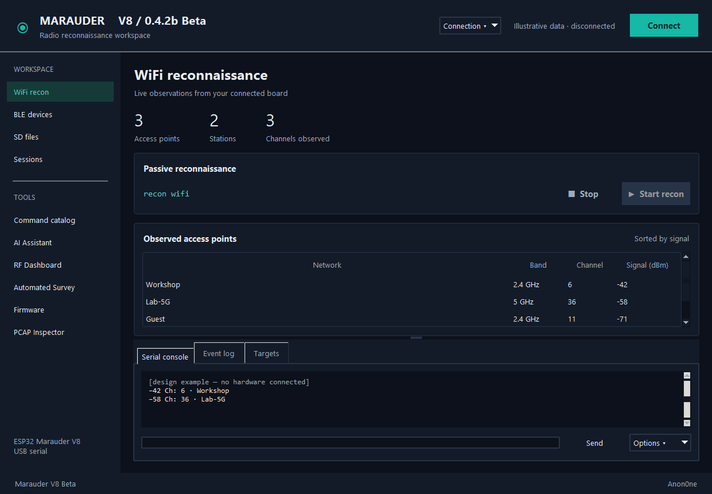

# Marauder V8 Control — 0.4.2b Beta
# Note: If you want full features, and to use our new additions you must flash Specter firmware to your Marauder V8. We have only tested the V8 nothing else.

0.4.2b Beta improves reliability and GPS/wardrive controls. The major Workspace GUI remains experimental; community feedback will determine whether we retain it. Read [development changes](CHANGELOG-development.md), [audit and plan](docs/AUDIT_AND_PLAN.md), [firmware comparison](docs/COMMAND_COMPARISON.md), and [validation](docs/VALIDATION.md).



_The Workspace interface (illustrative data, device disconnected)._

## What it does

The dark **Workspace** GUI drives the ESP32 Marauder V8 (ESP32‑C5) over USB serial:

- **Command catalog** grouped by radio (WiFi / Bluetooth / Device), mirroring the
  on‑device menu — pick a command, fill parameters, and the exact string builds with
  inline per‑command help.
- **Target pickers** (double‑click scanned APs / stations / SSIDs / hosts) and an
  **in‑place Stop** for long‑running operations.
- **Live RF dashboard**, **BLE inventory/history**, **Automated passive survey**
  (JSON/CSV/KML), **SD browser**, **PCAP inspector**, **session record/replay**,
  **firmware updater**, and an optional **local/cloud AI assistant**.

**→ Full usage walkthrough and the complete console‑command reference:
[docs/USER_GUIDE.md](docs/USER_GUIDE.md). Quick answers: [FAQ](docs/FAQ.md).**

## Console commands

Everything rides on a 115200‑baud serial CLI. In the GUI, type into the **Raw** box,
or use the standalone CLI:

```bash
python marauder.py ports            # list serial ports
python marauder.py fwhelp           # dump the firmware's own command list (ground truth)
python marauder.py send "list -a"   # one command
python marauder.py monitor          # interactive console
```

Common device commands: `recon wifi` / `recon ble` (discover), `list -a/-s/-c/-b`
(view AP/station/SSID/BLE lists), `select -a 0,2` (choose targets), `sniffpmkid`
(capture handshakes/PMKID), `attack -t deauth` (authorized targets only),
`blespam -t sourapple`, `wardrive`, `channel -s 6`, `stopscan`. The
[User Guide](docs/USER_GUIDE.md) documents all 96 catalog commands with their syntax.

## Run and build

Windows test packages include `INSTALL_WINDOWS.cmd`: extract the entire package
and run it to install the EXE and Desktop/Start Menu shortcuts without Python.
For portable use, launch `MarauderV8-Control.exe` directly. The public package
includes shared Specter controls; it does not bundle the private Pro add-on.
See [Windows instructions](WINDOWS_INSTALL.txt) and
[verification coverage](docs/WINDOWS_VERIFICATION.md).

Source: install requirements.txt and launch marauder_workspace.py.
`BUILD_AND_INSTALL.cmd` builds from source and uses the same Windows installer. For the repeatable tested build, use Python 3.12.10 x64:

```powershell
powershell.exe -NoProfile -ExecutionPolicy Bypass -File .\BUILD_REPRODUCIBLE.ps1
```

Add `-EnableNPU` to include the optional runtime, or `-PythonExe "C:\path\to\python.exe"` if the Python launcher is unavailable. Models remain separate downloads. The script creates a fresh virtual environment, installs pinned packages, checks dependencies, runs tests and builds the standalone executable. Repeatable inputs do not imply a byte-for-byte identical EXE; packaging metadata and the Windows build host can affect hashes.

Linux source: `bash INSTALL_AND_RUN.sh`, or install requirements.txt in a virtual environment and run marauder_workspace.py. Linux execution has not been tested here.

## Passive analysis boundary

Automated Survey starts Wi-Fi reconnaissance once, records sessions by default, and collects observations until Stop. It does not rotate/restart RF operations. Existing manual recording and all command pages remain available.

Official BLE recon uses active scanning. BLE acquisition remains a manual operator action; received BLE observations can be logged and analyzed. It is not an autonomous receive-only scanner. Eight legacy catalog commands are flagged as unverified in current official firmware; consult the installed device's help.

Local AI uses Ollama on loopback. Verify an installed model, analyze observations or save a diagnostic report. Exact passive-command automation is optional; unknown/transmitting commands are never loaded or sent by AI. Report generation never executes commands. NPU/Hybrid remains experimental after the prior device-lost error.

Live inventories are capped at 4096 rows, console/chat displays are bounded, and replay accepts sessions up to 128 MiB. Save session recordings for complete long-running observation history. Received data and reports may contain private network information.

Project: https://github.com/Anon0ne/marauder-v8-gui

## Existing tools retained

Dark Workspace navigation, manual command catalog, Wi-Fi/BLE inventories, RF dashboard, SD browser, PCAP inspector, JSON/CSV exports, GPS-based KML, session recording/replay and firmware flashing remain available. Firmware flashing is an app-only update and requires an existing compatible V8 bootloader/partition layout; use the official installer for full installation or partition migration.

Community resources: [Contributing](CONTRIBUTING.md), [Code of conduct](CODE_OF_CONDUCT.md), [Security](SECURITY.md), [Support](SUPPORT.md).

## Premium

The community edition remains free and open source under MIT. The existing
**Heatmap** feature ships in a separately licensed Pro add-on. New Specter
features are grouped here as the **Premium / Pro validation feature set**;
expanded entitlement lockouts remain deferred until testing is complete. The
current test branch exposes these controls without a new host license gate.
Firmware Red/Blue Team and BT+ arm requirements still apply.

| Premium feature area | New capabilities and current availability |
| --- | --- |
| **Heatmap** | GPS WiFi signal mapping and GeoJSON/KML/HTML reports; existing Pro add-on license checks apply. |
| **Specter Sessions** | Firmware run start/end/status, session organization and output indexes; the GUI also retains its existing recording/replay tools. |
| **Guardian and WiFi automation** | Deauth Guardian, exact-SSID Probe to Portal and scoped IoT Recon command forms, with status/stop routing. IoT Recon's post-ARP state check remains a known firmware issue. |
| **AP actions** | Per-AP Deauth/Clone controls, fresh device AP/BSSID verification and selected-template carryover for clone setup. |
| **Portal workflow** | Recursive existing SD-template discovery, filters, source viewing/offline preview, explicit template selection, editable setup, acknowledged startup and local submission-log metadata. |
| **SD and time integration** | CRC-checked file transfers, nested paths with spaces, modified dates, firmware UTC sync and known-date correction commands. The community SD browser remains available. |
| **BLE discovery and assessment catalog** | Tracker, Phantom, Beacon, Spoofer, Predator, SkeletonKey, WhisperPair, KARR and Skimmer forms; functionality and owned-target validation vary. |
| **Controls and status** | Specter help/status/session/clock replies, explicit BT+ arming and a global Stop active job action with module-aware stop routing. |
| **BadBLE keyboard / DuckyScript** | Companion Specter firmware now has touchscreen SD script selection, manual Run, progress and Stop/Back. Manual hello typing is user-confirmed on Android. Dedicated GUI forms are pending; use the raw console and SD browser with matching firmware. SD-script paired-host acceptance is still pending. |
| **Firmware touchscreen improvements** | Live BLE result screens, retained snapshots, device/GATT inspection, Stop/Back and BLE-to-WiFi memory release. These run on the handheld, not in a new GUI inspector. |

Run the validation build from `specter/pro-integration`:

```sh
bash run-pro.sh --no-autoconnect
```

Use a matching Specter firmware build. These forms send firmware commands;
they do not add radio capabilities to stock firmware. Most active BLE tools
still need target-device testing. Newer-pack Airoha, dedicated GARMR/auth-flood
upgrades and future license lockouts are not completed additions here.

[Integration and validation](docs/SPECTER_PRO_INTEGRATION.md) ·
[Portal workflow](docs/PORTAL_EXERCISE.md) ·
[AP actions and Stop](docs/AP_CLONE_AND_STOP.md) ·
[Specter firmware](https://github.com/Anon0ne/Specter/tree/specter/ble-touchscreen) ·
[BadBLE setup and commands](https://github.com/Anon0ne/Specter/blob/specter/ble-touchscreen/docs/BADBLE_KEYBOARD_TEST.md)

## Online AI without a GPU

Choose Cloud: OpenRouter Free or Cloud: Gemini and open Cloud settings. Bring your own API key and explicitly consent to sending prompts. Aggregate sharing is off by default; when enabled it sends counts, channels and RSSI ranges, excluding names, addresses, GPS and serial logs. Anything typed in prompts is sent to the provider. Keys are session-only unless Windows DPAPI storage is selected; Linux persistence is unsupported.

OpenRouter accepts openrouter/free or :free models, without paid fallback. Quotas and availability vary. Gemini offers eligible free tiers; billed accounts can incur charges and free-tier data can be used to improve provider products. Check [OpenRouter free router](https://openrouter.ai/docs/guides/routing/routers/free-router) and [Gemini pricing](https://ai.google.dev/gemini-api/docs/pricing). Real authenticated cloud requests remain untested; automated tests use mocked responses.

See [GPS and wardrive troubleshooting](docs/GPS_AND_WARDRIVE.md). GPS works on the user's device after a hardware correction; POI persistence requires an SD-card check.

## Optional portal library

[Rian's Evil Portals for Marauder](https://github.com/rianhanft/Rians_Evil_Portals_For_Marauder) is pinned as a Git submodule at `portals/rians`. Run `git submodule update --init --recursive -- portals/rians` from your source checkout. See [portal library setup](docs/PORTAL_LIBRARY.md) for recursive cloning, storage placement and packaging details.
