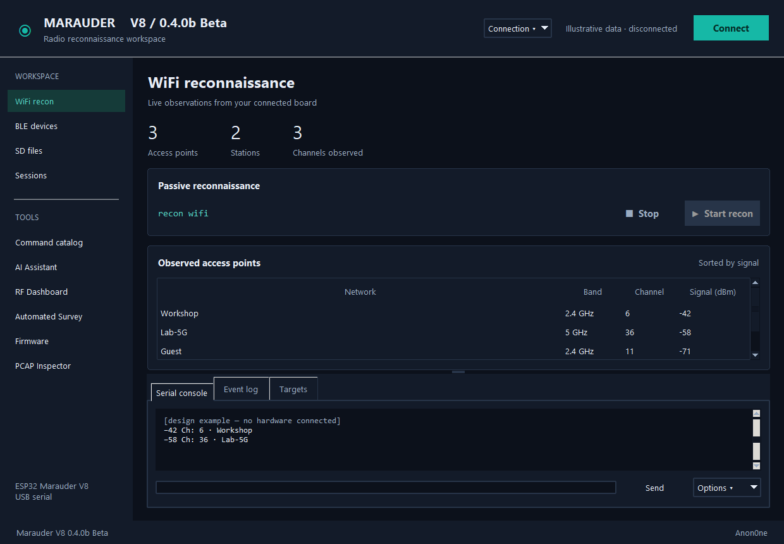

# Marauder V8 Control 0.4.0b Beta

## Major GUI change — community beta testing

The GUI has changed substantially for 0.4.0 Beta. Please test navigation, serial connection, continuous surveys, capture/export tools and AI controls, and report usability feedback or regressions through GitHub issues. We are not yet sure whether we will keep this interface; community feedback will help decide its future.

The screenshot uses illustrative data with the device disconnected.

This release brings the dark Workspace interface and expanded observation tools into the main application, with clearer installation choices and optional local AI acceleration.

- Persistent embedded pages, side console, responsive serial connection and preserved target selection.
- BLE inventory/history, read-only SD browser, PCAP inspection and JSON/CSV inventory exports.
- Session recording, receive-only replay, GPS capture and KML placemarks.
- Intel NPU support and separate NPU/GPU Hybrid jobs through OpenVINO and Ollama.
- Fixed continuous survey behavior: start reconnaissance once, collect until Stop, and cancel pending refresh callbacks. Removed repeated list/start/stop capture cycles.
- Improved AI prompting and repetition controls; render chat templates once. Unverified model commands no longer populate Raw.
- About description, prominent features and clickable project URL.
- Windows manual/automatic setup, Linux source installation, and community contribution/security/support standards.

Windows ZIP: portable Windows application and source/setup scripts. Linux ZIP: Python source and Linux setup scripts. Optional NPU models are downloaded separately.

Experimental NPU/Hybrid limitation: the latest NPU conversational retest returned a device-lost driver error. NPU answer quality and concurrent execution remain unverified for this beta; Ollama can be used independently.
